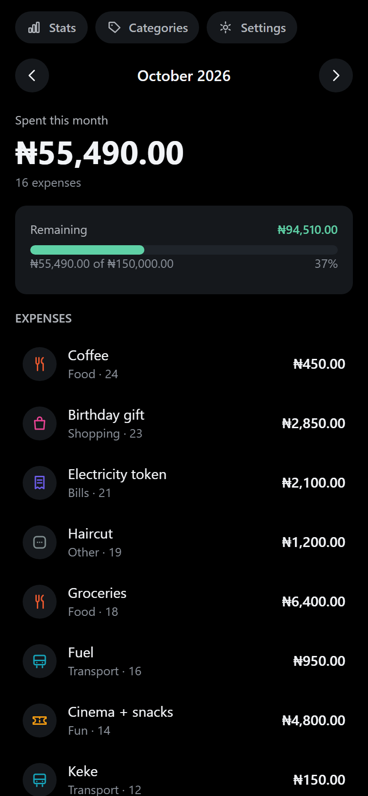
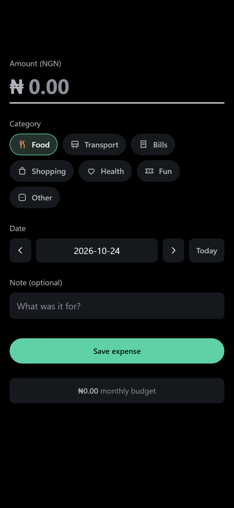
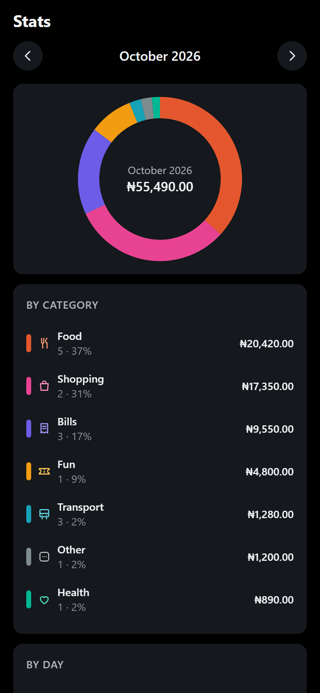
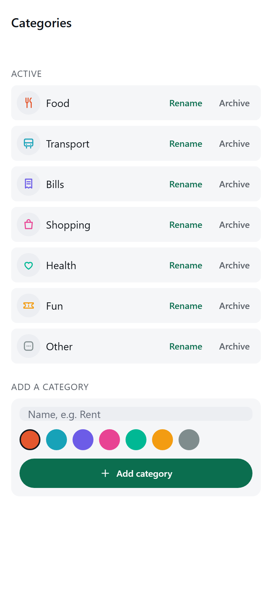
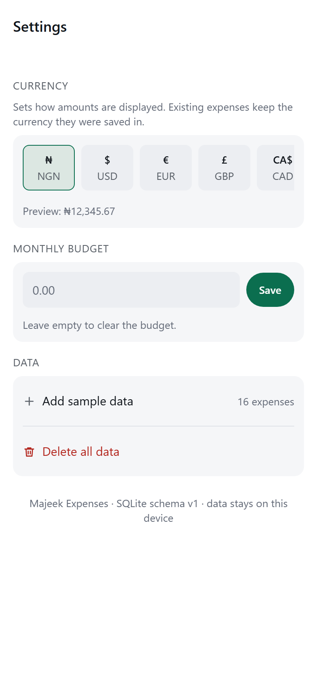
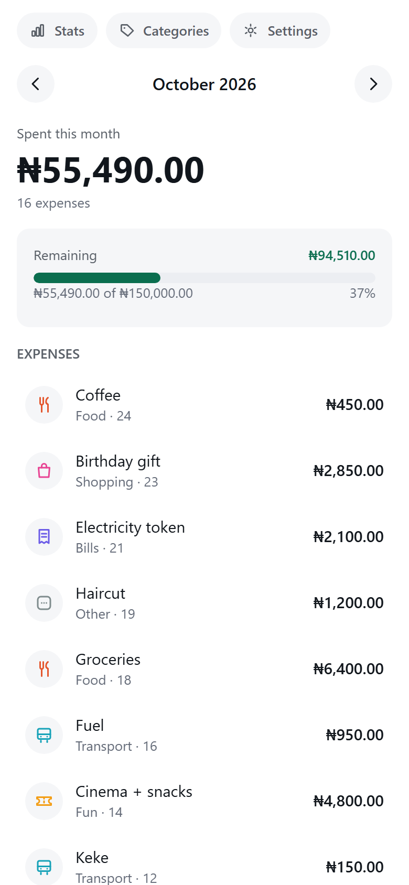

# Majeek Expenses

An offline expense tracker for iOS and Android, built with Expo and React Native.
Every expense lives in a **local SQLite database** on the phone. There is no account,
no sync, and no network call — the app makes none at all.

Built as App #3 of a 12-app mobile portfolio. The point of this one is **data modelling
over time**: an integer money type, local calendar days, and totals computed by SQL
`GROUP BY` rather than by adding up a list in the UI.

---

## What it does

- **Add, edit and delete expenses** — amount, category, date, and an optional note.
- **Categories** — seven seeded defaults, plus your own. Rename, recolour and archive;
  archiving hides a category from the picker while its past expenses keep their label.
- **Monthly totals** from SQL aggregates, with a month switcher.
- **Charts** — a donut of spend by category and a bar chart of spend per day, drawn as
  SVG so they render identically on web and Android.
- **Monthly budget** — one cap, a progress bar, and a clear over/under state.
- **Ten currencies** — NGN, USD, EUR, GBP, CAD, AUD, ZAR, INR, CNY, JPY. The default is
  your device's currency when it is one of those, otherwise **₦ NGN**.

| | | |
|---|---|---|
|  |  |  |
| Home — month total, budget, list | Add / edit an expense | Stats — donut and daily bars |
|  |  |  |
| Categories — rename and archive | Settings — currency and budget | Light mode |

---

## How to run it

```bash
npm install
npx expo start
```

Then scan the QR code with **Expo Go** on your phone.

> **The project targets Expo SDK 58, which is what the current Expo Go ships.** Expo Go
> supports exactly one SDK, and it updates itself from the app store — so if you see
> *"Project is incompatible with this version of Expo Go"*, check which SDK your Expo Go
> reports before changing anything in this repo.

To run the web preview: `npx expo start --web`. See [Web](#web) below for the one
extra requirement.

### Verification

```bash
node --experimental-sqlite --experimental-strip-types --import ./scripts/register-alias.mjs scripts/verify-db.mts
node --experimental-strip-types --import ./scripts/register-alias.mjs scripts/verify-logic.mts
node --experimental-strip-types --import ./scripts/register-alias.mjs scripts/verify-contrast.mts
node scripts/verify-docs.mjs
npx tsc --noEmit
```

The database script runs the **real** schema and repository modules against a real
SQLite engine via Node's built-in `node:sqlite`. It is not a mock, and it does not need a
browser.

---

## Architecture

```
src/app/                     routes (Expo Router)
      │  reads and writes only through hooks
      ▼
src/hooks/use-expenses.tsx   state, reload-after-write
      │
      ▼
src/db/repository.ts         every SQL statement, typed
      │
      ▼
src/db/driver.ts             the SqlDriver interface (exec / all / first / run)
      ├── drivers/native.ts  expo-sqlite   (Android, iOS, web)
      └── (scripts)          node:sqlite   (verification only)
      │
      ▼
src/db/schema.ts             DDL + PRAGMA user_version migrations
```

Four decisions carry most of the weight:

**Money is an integer in the currency's minor unit.** `amount_minor INTEGER`, never a
`REAL`. The reason is concrete: `0.1 + 0.2 !== 0.3`, and two hundred expenses summed that
way produce a total that disagrees with the rows above it. `scripts/verify-logic.mts`
asserts both halves of this — that float accumulation *does* drift, and that the integer
path does not.

**Dates are local calendar days**, stored as `TEXT 'YYYY-MM-DD'`. A coffee bought at 23:30
is `2026-10-24T22:30Z`; filing it by UTC timestamp puts a whole hour of late-evening
spending on the wrong day. Month ranges are inclusive string bounds, so a single
`spent_on BETWEEN ? AND ?` is index-friendly.

**Aggregates come from SQL.** `/` and `/stats` both read `monthSummary()`, so the header
total, the donut and the bars are three readings of one query and cannot disagree.

**The currency travels with the amount.** `expenses.currency` is stored per row. Changing
the setting re-renders history; it does not reinterpret a stored `1500` from ¥1,500 into
₦15.00. JPY has zero decimal places, which is exactly why the code has to be on the row.

### Schema

```sql
categories(id, name UNIQUE, color, icon, sort, archived CHECK IN (0,1))
expenses(id, amount_minor CHECK > 0, category_id → categories, spent_on GLOB ISO,
         note, currency, created_at, updated_at)
settings(key PRIMARY KEY, value)
```

Migrations are keyed on `PRAGMA user_version`, which SQLite keeps in the database header —
so nothing has to exist before the first migration can run. `PRAGMA foreign_keys = ON` is
set on every open, because it is per-connection and not stored in the file.

---

## Web

`expo-sqlite` on web runs a WebAssembly build that needs `SharedArrayBuffer`, which
browsers only expose on a **cross-origin-isolated** page. `metro.config.js` therefore does
two things: adds `wasm` to Metro's asset extensions, and injects the two headers on every
dev-server response:

```
Cross-Origin-Opener-Policy: same-origin
Cross-Origin-Embedder-Policy: credentialless
```

`credentialless` rather than `require-corp`, because `require-corp` also blocks the Metro
HMR websocket and any non-CORP remote asset.

This is **development only**. A production deploy needs the same two headers from the
host; Metro does not control the host, so they are not configured anywhere else.

---

## Verified

Everything below was measured, not assumed.

| Check | Result |
|---|---|
| `npx tsc --noEmit` | exit 0, no `any` in app code |
| `verify-db.mts` (real SQLite) | **49/49** — schema, constraints, aggregates, CRUD, persistence across reopen |
| `verify-logic.mts` | **68/68** — minor units, 10 currencies, calendar boundaries, donut geometry |
| `verify-contrast.mts` | **73/73** — both schemes, ≥4.5:1 |
| Browser at 390px | 0 elements clipped, `scrollWidth === innerWidth` |
| Both colour schemes | exactly one background per layer, no transition flash |
| SQLite on web | `crossOriginIsolated === true`, real write/read round-trip |
| Charts | 33 SVGs / 59 paths / 40 rects, **0 images** |
| Console | 0 errors, 0 nested `<button>` elements |
| Screenshots | 6/6 distinct SHA-256 hashes |

A worked example from the browser run: 16 seeded expenses plus one typed as `1234.56`
produced a header total of **₦56,724.56** and a count of **17**. Summing the 16 seed
amounts by hand gives ₦55,490.00, and `55,490.00 + 1,234.56 = 56,724.56` — so the SQL
aggregate and the stored rows agree exactly. The figure survived a full page reload.

---

## Known limitations

**Worth fixing later**

- **No CSV or PDF export.** Deferred deliberately to App #5 (Majeek Budget), which the
  roadmap already assigns export to. `expo-file-system` documents no web support, so an
  export path is also the most platform-divergent feature this app could add.
- **Web SQLite depends on cross-origin isolation.** If you deploy the web build, the host
  must send COOP/COEP or the database will not open. The app shows a real error state
  naming this, rather than an empty list.
- **Deleting a category is archiving, not deleting.** A hard delete would orphan the
  expenses that reference it. This is intentional, but there is no way to remove an
  archived category from the list yet.
- **One budget, not per-category budgets.** Per-category budgets and rollover belong to
  App #5; this app has a single monthly cap by design.

**Safe to ignore**

- **No sync or backup.** Uninstalling the app deletes the database permanently. That is
  the Tier-0 design; the first backend arrives in App #4.
- **The database is not encrypted.** It holds no secrets — only your own spending.
- **No recurrence.** Recurring expenses need a scheduler and catch-up logic; out of scope.

---

## Notes and lessons

The full engineering log is in [`docs/NOTES.md`](docs/NOTES.md) and
[`docs/PLAN.md`](docs/PLAN.md). Three that shaped the code:

1. **`victory-native` was ruled out on evidence.** v43 requires
   `react-native-skia@^2.15.1`, which is not bundled in Expo Go, so it would have forced a
   custom development build and broken the free QR workflow. The charts are hand-drawn on
   `react-native-svg` instead — zero new dependencies, identical output everywhere.
2. **The SDK was pinned to the wrong version first.** The project was briefly on SDK 57
   because the previous two apps used 57, and a real QR scan immediately failed because
   Expo Go had auto-updated to 58. The rule is now: probe the QR early and read the SDK
   from the error, rather than inferring it from an older project.
3. **A contrast test caught a real bug before shipping.** `textMuted` measured 3.79:1 on
   white — below AA — and it is the colour used for chart axis labels. Testing both
   schemes is what surfaced it; the dark scheme alone would have passed.

---

## Licence

MIT. See [LICENSE](LICENSE).
